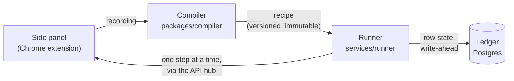

# ProcessLens

**Teach a browser task once. ProcessLens runs it on every row of a spreadsheet, checks each one,
and never does anything twice.**

[](https://github.com/jayanthvee/process-lens/actions/workflows/ci.yml)


> **Status:** early. Three real tasks run live today (see [What works today](#what-works-today)).
> Not ready for production data.

## What it does

Many teams still move data into web apps by hand. They read a spreadsheet row, then type it into a
CRM, an admin screen or a portal that has no usable API. It is slow, and a mistake such as a price
changed twice or a person enrolled twice takes longer to undo than to enter.

With ProcessLens, a person does the task once in their own Chrome, from the ProcessLens side panel.
ProcessLens turns that into a fixed, readable task, tries it on one row for approval, and then runs
it on every row of the file.

- **Every row ends in one clear outcome:** done, skipped, failed, or set aside for a person, each
  with a reason.
- **Every change is checked.** A row is done only when the site confirms it: the value read back,
  the page it lands on, or a confirmation. A click being sent is not enough.
- **Nothing is done twice.** Each row's progress is written to a ledger before the save is sent, so
  a crash, a lost connection or a re-run of the same file does not repeat work.
- **People stay in charge.** The first row waits for approval. Anything uncertain stops and asks.
- **No stored passwords.** Runs use the person's own signed-in browser session.

Models help only where rules can't reach: finding an element on a page that changed. A model never
decides whether a row is done. That comes only from a check.

## How it works



1. **Teach.** In the side panel, press **Teach a task**, do the task once on one row, and press
   **Stop**. The extension records what you did. Password fields are never recorded.
2. **Compile.** The compiler reads the recording as an update or a create, and turns it into a
   recipe: a fixed list of steps, each with a check that runs after it.
3. **Run.** You pick the spreadsheet. The runner sends one step at a time to your browser, through
   the API's hub, and checks what the page shows after each one.
4. **Record.** The ledger in Postgres holds every row's state. It decides what happens after a
   crash: a row that was mid-save is checked on the site before anything is retried.

More detail: [Architecture](internal/docs/ARCHITECTURE.md) ·
[Ledger](internal/docs/LEDGER_SPEC.md) · [Recipes](internal/docs/RECIPE_SPEC.md) ·
[AI at run time](internal/docs/AI_RUNTIME.md).

## What works today

The product is designed around [ten use cases](internal/docs/PRODUCT.md#the-ten-use-cases). These
run live today, taught and run from the side panel:

| Task | Site | What happens per row |
| --- | --- | --- |
| Price update (use case 4) | Odoo Sales | Open the product, set the new price, save, read the price back |
| Event enrollment (use case 6) | Odoo Events | Enroll the person in the event, save, check the enrollment |
| Sign-in with an email code | Goodlabs | Sign in with a one-time code sent by email |

Not built yet: reading PDFs and other documents, and the other eight use cases.

## Quick start

### Use a hosted ProcessLens

1. Get the extension zip from your admin and load it in Chrome. Steps:
   [Installing the extension](internal/docs/INSTALL-EXTENSION.md).
2. Open the side panel, sign in to the site you want to work on (for example Odoo), and press
   **Teach a task**.
3. Do the task once, press **Stop**, answer the panel's questions, and press **Save as task**.
4. Pick your spreadsheet, try the first row, approve it, and run the rest.

To host it yourself: [Deploying on Render](internal/docs/DEPLOY_RENDER.md).

### Run it on your machine

You need Docker with Compose v2, Python 3.12, Node 22, and GNU Make.

```bash
cp .env.example .env            # Windows: copy .env.example .env
make up                         # Postgres 16 and MinIO

python -m venv .venv
source .venv/bin/activate       # Windows: .venv\Scripts\activate
pip install -e ".[dev]"

make demo ARGS="--extension-id <your extension id>"
```

`make demo` applies the migrations, builds the web app and the extension if needed, starts the API
on `http://127.0.0.1:8000`, and starts a runner when a run is waiting. It prints the next steps:
load `apps/extension/dist` with **Load unpacked** in `chrome://extensions`, and connect to that
address. Run it once without `ARGS` to see your extension id.

### Try it on Odoo

[`infra/test-apps`](infra/test-apps/README.md) runs Odoo 18 Community (and Twenty CRM) on your
machine, seeded with test data:

```bash
docker compose -f infra/test-apps/docker-compose.yml up -d
python infra/test-apps/reset.py odoo
```

Sign in at `http://localhost:8069`, teach a price change on one product, and run
[`usecase-4-products.csv`](infra/test-apps/samples/usecase-4-products.csv). One of its rows names a
product that does not exist, so you can see how a row that can't be done is reported.

The local Odoo does not install the Events app yet, so try enrollment on an Odoo that has it.

## Repository layout

```
apps/
  extension/     Chrome extension: side panel, recorder, step executor
  web/           Dashboard and side panel UI (React)
packages/
  compiler/      Recording -> recipe
  recipe/        Recipe schema
  ledger/        Row state and duplicate keys
  documents/     Document reading (early)
  shared/        Shared code
services/
  api/           HTTP API, the extension hub, the dashboard
  runner/        Runs a recipe over a batch, one row at a time
  ai/            The only path to a model, with checks on every answer
  documents/     Document processing (early)
db/              Postgres migrations, including the ledger's state machine
infra/           Local test apps (Odoo, Twenty)
fixtures/        Test sites, sample files and documents
tests/           Cross-cutting and end-to-end tests
internal/docs/   Product, architecture and decisions
```

## Development

```bash
python -m pytest -q                       # Python tests
python -m pytest packages/compiler -q     # compiler tests only
ruff check . && ruff format --check .     # lint and format
npm --prefix apps/extension run check     # extension: typecheck, tests, build, validate
npm --prefix apps/web run check           # web: typecheck, tests, build
```

CI runs all of these, plus a secret scan, on every push. The full Python suite includes browser
tests and takes a while; run the folder you changed first.

`make up` / `make down` start and stop the local services. Their data stays in Docker volumes. The
credentials in `.env.example` are for local development only.

## Documentation

| Document | What it covers |
| --- | --- |
| [Product](internal/docs/PRODUCT.md) | The problem, the users, and the ten use cases |
| [Architecture](internal/docs/ARCHITECTURE.md) | Components, what each one owns, and how they talk |
| [Decisions](internal/docs/DECISIONS.md) | Every design decision, with its reason |
| [Installing the extension](internal/docs/INSTALL-EXTENSION.md) | Loading the zip in Chrome, and building it |
| [Deploying on Render](internal/docs/DEPLOY_RENDER.md) | Hosting the API, the runner and Postgres |
| [Security model](internal/docs/SECURITY_MODEL.md) | What is recorded, what is never stored, and why |

## Security

Please report vulnerabilities privately. See [SECURITY.md](SECURITY.md).

## License

Copyright © 2026 the ProcessLens authors. All rights reserved.
The source is visible for review. No license to use, copy, or modify it is granted at this time.
